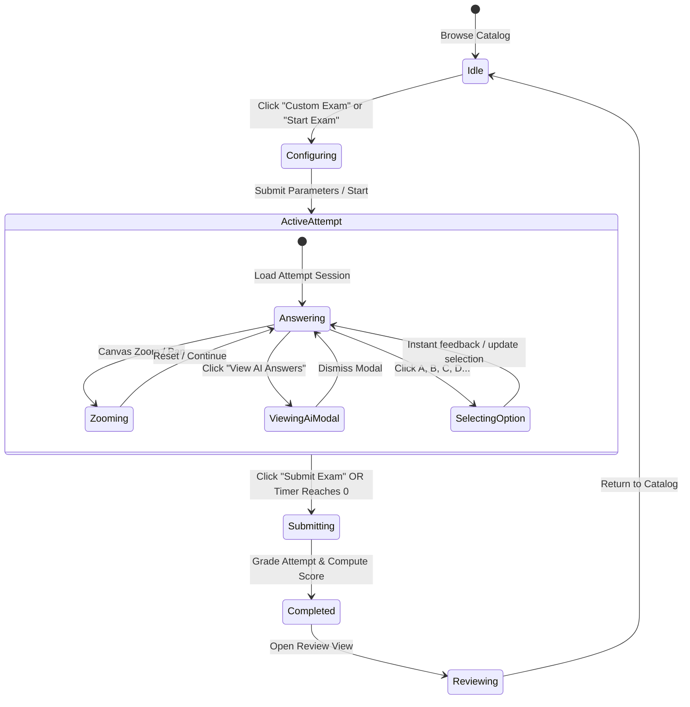

# Phase 1 Data Model: Exam Practice Platform

**Feature**: `001-exam-practice-app` | **Date**: 2026-11-12

## 1. Domain Entities & Client State

### 1.1 User & Authentication State
Represents the active user credentials and session profile.

```typescript
export interface UserProfile {
  id: string;
  email: string;
  fullName: string;
  createdAt: string; // ISO date string
}

export interface AuthSession {
  accessToken: string | null;
  user: UserProfile | null;
  isAuthenticated: boolean;
  isLoading: boolean;
}
```

- **Validation Rules**:
  - `email`: Valid RFC 5322 format, non-empty.
  - `password`: Minimum 8 characters during registration.
  - `accessToken`: Persisted in secure `localStorage` under key `fuo_auth_token`.

---

### 1.2 Subject & Catalog
Represents course subject matter and metadata.

```typescript
export interface Subject {
  id: string;
  code: string; // e.g. "MAD101", "NWC204", "OSG202", "PRO192"
  title: string; // e.g. "Discrete Mathematics"
  description: string;
  iconUrl: string | null;
  totalExams: number;
}
```

---

### 1.3 Exam & Practice Configuration
Represents both standard curated exams and dynamically configured practice sessions.

```typescript
export interface ExamSummary {
  id: string;
  subjectCode: string;
  code: string; // e.g. "MAD101 - FA25 - FEB5"
  title: string;
  durationMinutes: number;
  totalQuestions: number;
  passingScorePercentage: number; // default 70.0
}

export type FeedbackMode = "instant" | "post_exam";
export type BenchmarkMode = "ai" | "community";

export interface CustomPracticeConfig {
  subjectCode: string;
  durationMinutes: number | null; // null for untimed practice
  totalQuestions: number; // 5 to max available
  feedbackMode: FeedbackMode; // "instant" vs "post_exam"
  benchmarkMode: BenchmarkMode; // "ai" vs "community"
}
```

- **Validation Rules**:
  - `durationMinutes`: If set, must be between 5 and 180 minutes.
  - `totalQuestions`: Must be between 1 and the subject question bank total (clamped to max available).
  - `passingScorePercentage`: Standardized at 70.0%.

---

### 1.4 Question & Pedagogical Solution
Represents a question item with options, diagrams, and AI solution data.

```typescript
export type QuestionType = "single_choice" | "multiple_choice";

export interface QuestionOptionMap {
  [optionKey: string]: string; // "A": "...", "B": "...", etc.
}

export interface Question {
  questionId: string;
  questionNumber: number;
  questionIdCode: string; // e.g. "Q1"
  questionType: QuestionType; // "single_choice" | "multiple_choice"
  questionText: string;
  imageUrl: string | null; // e.g. "/static/exams/MAD101/MAD101%20-%20FA25%20-%20FEB5/Q1.webp"
  options: QuestionOptionMap;
  selectedOptions?: string | null; // user's choice e.g. "C" or "ACD"
}

export interface AiExplanationDetail {
  aiChoice: string; // e.g. "C"
  aiModel: string; // e.g. "gemini-3-flash-preview"
  aiExplanation: string; // Step-by-step reasoning
  optionByOptionAnalysis?: Record<string, string> | null;
  comparisonNote?: string | null;
}

export interface CommunityStats {
  totalComments: number;
  validVoteCount: number;
  topAnswerVotes: number;
  agreementRatio: number;
  communityAnswer: string | null;
}
```

---

### 1.5 Active Exam Attempt Session (Client & Server Synchronized)
Represents the live state of an in-progress exam.

```typescript
export type AttemptStatus = "in_progress" | "completed" | "expired";

export interface AttemptSession {
  attemptId: string;
  examId: string;
  examTitle: string;
  status: AttemptStatus;
  startedAt: string; // ISO string
  expiresAt: string; // ISO string
  timeRemainingSeconds: number; // Synchronized from server
  questions: Question[];
  currentQuestionIndex: number;
  // Map of questionId -> selected choice (e.g. "C")
  userAnswers: Record<string, string>;
  // Instant feedback state per question (in instant mode)
  instantFeedbackResults: Record<
    string,
    {
      isCorrect: boolean;
      correctAnswer: string;
      revealed: boolean;
    }
  >;
}
```

---

### 1.6 Exam Result & Review Entity
Represents the final evaluation and post-exam review.

```typescript
export interface AttemptResult {
  attemptId: string;
  status: "completed";
  totalQuestions: number;
  correctAnswersCount: number;
  totalScore: number; // scale of 10.0
  percentageScore: number; // 0.0 to 100.0
  isPassed: boolean; // percentageScore >= passingScorePercentage
  submittedAt: string;
  durationSeconds: number;
}

export interface ReviewQuestionItem extends Question {
  correctAnswer: string;
  isCorrect: boolean;
  aiExplanation: string | null;
  aiModel?: string | null;
  optionByOptionAnalysis: Record<string, string> | null;
  communityStats: CommunityStats | null;
}

export interface AttemptReview {
  attemptId: string;
  examTitle: string;
  percentageScore: number;
  isPassed: boolean;
  submittedAt: string;
  questions: ReviewQuestionItem[];
}
```

---

## 2. State Transitions & Lifecycle

### 2.1 Exam Lifecycle State Machine



---

## 3. UI Component View State (Zustand Store)

```typescript
export interface ExamUiState {
  currentQuestionIndex: number;
  activePage: number; // 1-based index for Question List sidebar pagination
  zoomLevel: number; // 1.0 default, bounds: [0.5, 3.0]
  panPosition: { x: number; y: number };
  isAiModalOpen: boolean;
  isSubmitConfirmOpen: boolean;
  benchmarkMode: BenchmarkMode;
  
  // Actions
  setQuestionIndex: (index: number) => void;
  nextPage: () => void;
  prevPage: () => void;
  zoomIn: () => void;
  zoomOut: () => void;
  resetZoom: () => void;
  openAiModal: () => void;
  closeAiModal: () => void;
  setBenchmarkMode: (mode: BenchmarkMode) => void;
}
```
